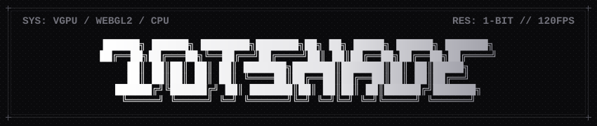

<div align="center">
  

  <p align="center">
    <a href="https://nextjs.org"></a>
    <a href="https://react.dev"></a>
    <a href="https://www.typescriptlang.org"></a>
    <a href="https://www.w3.org/TR/webgpu/"></a>
    <a href="https://www.khronos.org/webgl/"></a>
    <a href="LICENSE"></a>
  </p>

  <p align="center">
    Browser-based dithering for images, video, webcams, and procedural patterns.
  </p>
</div>

## Engines

| Backend | Implementation | Target |
| :--- | :--- | :--- |
| **WebGPU** | [`vgpu`](https://vgpu.sh) / WGSL compute & fragment | Hardware acceleration for video, live webcam, and large canvas viewports |
| **WebGL2** | GLSL ES 3.00 fragment shaders | Hardware-accelerated fallback compatible with all modern browsers |
| **CPU** | Multi-pass 2D Canvas `ImageData` | Exact pixel-space error diffusion (Atkinson, Floyd-Steinberg, etc.) |

---

## Algorithms

### GPU Ordered Dithering & Screening
- **Bayer Matrices**: `2x2`, `4x4`, `8x8`, `16x16` threshold arrays
- **Halftone Dot Screen**: Rotatable dot-screen raster with angle (`0°-360°`) and frequency controls
- **Crosshatch**: Dual diagonal etching lines
- **Clustered Dot**: Coarse newsprint-style matrix
- **Noise**: High-frequency white noise dither

### CPU Error Diffusion
- **Floyd-Steinberg (1976)**: 4-neighbor spatial error distribution
- **Atkinson (1984)**: Bill Atkinson's 6-neighbor 3/4 diffusion used in MacPaint
- **Sierra-3 & Sierra Lite**: 3-line and 2-line balanced diffusion filters
- **Burkes**: 7-neighbor filter with smooth tonal transitions
- **Stucki**: 12-neighbor filter tuned for edge preservation
- **Jarvis-Judice-Ninke**: 12-neighbor smoothing matrix

---

## Getting Started

### Requirements
- Node.js 20+
- pnpm (recommended) or npm / yarn

### Installation

```bash
git clone https://github.com/SoulDev07/DotShade.git
cd DotShade
pnpm install
```

### Development

```bash
pnpm dev
```

Open [http://localhost:3000](http://localhost:3000) in your browser.

### Build

```bash
pnpm build
pnpm start
```

---

## Tech Stack

- **Framework**: Next.js 16
- **UI**: React 19, Tailwind CSS v4
- **WebGPU Library**: [`vgpu`](https://vgpu.sh) (Vercel Labs)
- **Shaders / Canvas**: WGSL, WebGL2 (GLSL), Canvas 2D
- **Icons**: Phosphor Icons

---

## License

This project is licensed under the [MIT License](LICENSE).

